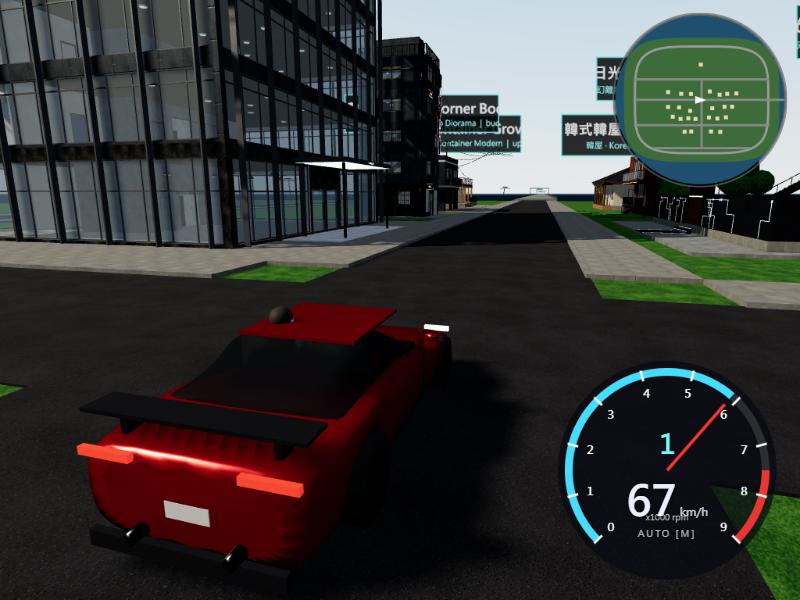
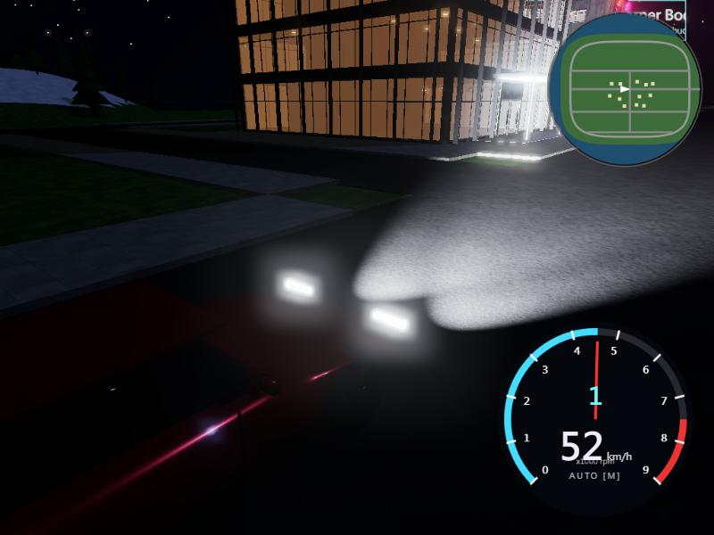
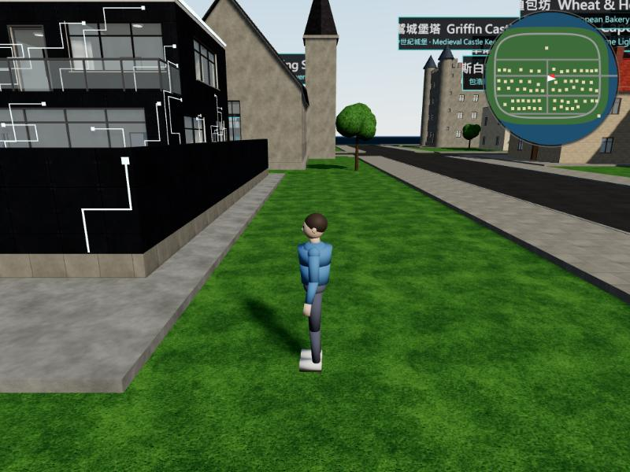

# TownKit 海港小鎮島 — three.js 開車 / 散步

在一座有 **67 棟可進入建築** 的小島上散步、跑步、上下樓梯，或跳上跑車在環島公路與 3 km 海上快速道路飆到 **300 km/h**（6 速變速箱模擬換檔）。



| | |
|---|---|
|  |  |

## 操作

| 模式 | 按鍵 |
|---|---|
| 步行 | `WASD` 移動 · `Shift` 跑步 · `Space` 跳 · 滑鼠 視角 · 滾輪 拉近 · 靠近門自動開啟 |
| 上/下車 | 靠近車按 `F`（車速 < 15 km/h 才能下車） |
| 開車 | `W` 油門 · `S` 煞車（停住後倒車）· `A/D` 轉向 · `Space` 手煞車甩尾 · `R` 車輛重置 |
| 變速箱 | 預設自排；`M` 切手排，`Q/E` 降/升檔 |
| 其他 | `N` 日/夜 · `V` 第一/第三人稱 · `P` 陰影開關 · `H` 說明 |

## 車輛模擬（`src/car.js`）
- 引擎扭力曲線（峰值 660 Nm @ 5500 rpm，紅線 8000 rpm，斷油抖動）
- 6 速齒比 3.40 / 2.36 / 1.79 / 1.38 / 1.10 / 0.88，終傳 3.42；起步離合器半聯結；升檔 0.22 s / 降檔 0.16 s 動力中斷 + 補油音效
- 自排在 7350 rpm 升檔、< 2900 rpm 或煞車時降檔；300 km/h 電子限速
- 空氣阻力 + 滾動阻力 + 循跡極限；速度感應轉向、手煞車甩尾、車身俯仰/側傾、四輪貼地取樣、牆面碰撞反彈
- 實測：0–100 km/h 4.2 s、0–200 km/h 9.9 s、0–300 km/h 25.1 s；300 → 0 km/h 煞車 8.1 s / 323 m
- WebAudio 合成 V8 引擎聲（隨轉速）、胎噪、風切聲

## 檔案
```
index.html, style.css      UI + importmap（three@0.170、three-mesh-bvh@0.8.3 走 CDN，免建置）
src/main.js                 主迴圈、相機、上下車、日夜、Bloom
src/world.js                載入島嶼與 67 棟建築（近的先載）、碰撞 BVH、環島公路 + 海上快速道路、自動門、名牌
src/player.js               膠囊碰撞角色控制（走/跑/跳/上樓梯）
src/car.js / audio.js / hud.js
models/                     Draco 壓縮 glTF + 共用 512px WebP 貼圖（約 30 MB）
  b_<id>.gltf / i_<id>.gltf 建築外殼 / 室內家具（近距離才載入）
  collider.glb              合併碰撞網格；hero.glb（14 骨骼 + Idle/Walk/Run/Jump/Drive）；car.glb
  manifest.json             每棟建築的名稱、風格、位置
docs/CATALOG.md, catalog.json   建築資產目錄（給人/AI 查詢）
pipeline/                   Blender 5.2 產生腳本（build.py、export_web.py、make_actors.py …）
```

## 本機執行
任何靜態伺服器即可，例如：
```bash
python -m http.server 8000
```
然後開 http://localhost:8000

## 部署到 Vercel
這是純靜態網站（無 build step）。在 Vercel「Add New Project」匯入此 GitHub repo，Framework 選 **Other**，Build Command 留空，Output Directory 留空（根目錄）即可。

## 重新產生資產（需要 Blender 5.2）
```bash
blender -b --factory-startup -P pipeline/build.py               # 建 TownKit.blend（67 棟）
blender -b TownKit.blend -P pipeline/export_web.py -- models    # 匯出網頁版模型
blender -b --factory-startup -P pipeline/make_actors.py -- models
```
